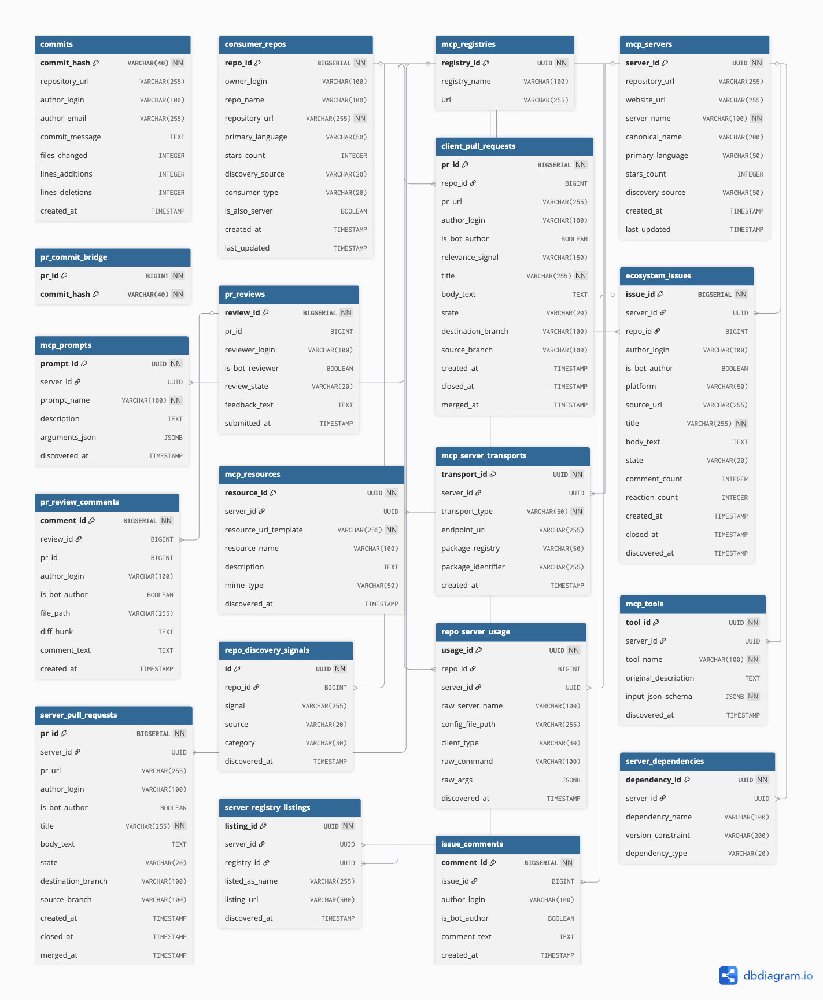

# Data dictionary

This page describes the tables of the frozen release
`c8edfd4bdf51b15ea95d6b0ede5dec97945f398a`. The authoritative column list and
constraints are in [`release/schema.sql`](../release/schema.sql), the PostgreSQL
schema distributed with the release.



The diagram is an overview. Where it and `schema.sql` disagree, `schema.sql`
defines the released columns and constraints.

## Reading the Parquet files

- Each table is one file, `parquet/<table>.parquet`.
- Foreign keys are declared in `schema.sql`. Parquet does not enforce them.
  Check references before relying on a join (see `queries/reference_checks.sql`).
- UUID columns use the Arrow `uuid` type. DuckDB reads them as `UUID`. Convert
  them to strings before comparing with text.
- JSON columns are stored as strings: `mcp_tools.input_json_schema`,
  `mcp_tools.output_json_schema`, `mcp_prompts.arguments_json`,
  `server_registry_listings.listing_metadata`, and `repo_server_usage.raw_args`.
  Parse them with `json.loads`.
- Timestamps have no time zone.
- Parquet types can differ from `schema.sql`. For example,
  `mcp_servers.stars_count` is stored as a floating-point column.

## Tables

Record counts come from the Parquet footers and match
`release/collection_metadata.json`. `python scripts/verify_release.py --check`
regenerates them. They count stored rows, not validated entities.

### Server candidates and capabilities

| Table | Records | Unit | Key columns |
| --- | ---: | --- | --- |
| `mcp_registries` | 7 | Seeded registry record. Not evidence of a successful crawl. | `registry_id` |
| `mcp_servers` | 78,302 | Candidate server project, deduplicated chiefly by repository URL | `server_id`, unique `repository_url` |
| `server_registry_listings` | 65,233 | Listing of a candidate in a registry | `server_id`, `registry_id`, unique together |
| `mcp_server_transports` | 45,272 | Launch command or endpoint | `server_id`, `package_identifier` |
| `mcp_tools` | 284,845 | Tool observation, per source | `server_id`, `tool_name`, `source`, unique together |
| `mcp_resources` | 20,795 | Resource observation, per source | `server_id`, `resource_uri_template`, `source`, unique together |
| `mcp_prompts` | 8,983 | Prompt observation, per source | `server_id`, `prompt_name`, `source`, unique together |
| `server_dependencies` | 662,693 | Declared dependency from a manifest | `server_id` |

Important columns:

- `mcp_servers.discovery_source` is a comma-joined set of the channels that
  surfaced the candidate: `registry`, `package`, `code`.
- `mcp_servers.canonical_name` is a namespaced identity when available. It does
  not prove that a manifest was inspected.
- `mcp_servers.stars_count` was recorded at discovery time. Values are not a
  synchronized snapshot.
- `mcp_server_transports.package_identifier` can occur for several servers.
  Check that a package maps to one server before following it. The engineer
  example does this.
- `mcp_tools.input_json_schema` is the tool's JSON input schema where
  available. `mcp_tools.tdqs_grade` is Glama's tool-description quality grade
  when present.

### Capability sources

| `source` | Meaning |
| --- | --- |
| `probe` | Observed. The pipeline launched or connected to the candidate and called `tools/list`, `resources/list`, or `prompts/list`. |
| `glama` | Reported. Copied from capability lists published by the Glama directory. |

The same capability can appear once per source. Pick one source, or compare
sources explicitly. A candidate that was not probed, or whose handshake failed,
has no `probe` rows. Missing rows are not an empty capability set.

### Consuming repositories

| Table | Records | Unit | Key columns |
| --- | ---: | --- | --- |
| `consumer_repos` | 16,165 | Candidate consuming repository | `repo_id`, unique `repository_url` |
| `repo_discovery_signals` | 45,529 | Code-search match | `repo_id`, `signal`, unique together |

`consumer_repos.consumer_type` summarizes the discovery signals:

| `consumer_type` | Evidence |
| --- | --- |
| `ai_user` | Parsed configurations or host-configuration search signals |
| `ai_builder` | Client SDK imports or agent framework adapters |
| `both` | Both kinds of evidence |
| `sdk_unconfirmed` | Ambiguous evidence, such as a bare MCP SDK dependency |

Inspect the distinct values before filtering, since other values may occur. A
signal shows that a repository references MCP. It does not prove adoption.
`is_also_server` records a URL match to `mcp_servers`, not a validated server.

### Configuration declarations

| Table | Records | Unit | Key columns |
| --- | ---: | --- | --- |
| `repo_server_usage` | 9,200 | Configuration declaration | `repo_id`, `raw_server_name`, `config_file_path`, unique together. `server_id` is nullable. |

Each row is one server entry parsed from a committed MCP configuration file. It
keeps the raw server name, command, arguments (`raw_args`), and file path. When
the entry matched a candidate server, `server_id` is set and `match_method`
records how. Otherwise `server_id` is null. The row has no file commit
identifier, so the exact historical file revision is not recorded.

To count links, drop null `server_id` values and reduce to distinct
`(repo_id, server_id)` pairs. One repository can declare a server in several
files. `queries/paper_listing.sql` follows this rule.

### Development records

| Table | Records | Unit | Key columns |
| --- | ---: | --- | --- |
| `commits` | 9,336,613 | Commit, keyed globally by hash | `commit_hash`, `repository_url` |
| `server_pull_requests` | 1,610,439 | Stored pull request row on a server repository. One pull request can have two rows. | `pr_id`, `server_id`, `pr_url` (see `pr_key`) |
| `client_pull_requests` | 121,161 | Signature-matched coding-agent pull request | `pr_id`, `repo_id` |
| `pr_reviews` | 620,151 | Pull request review | `review_id`, `pr_id` |
| `pr_review_comments` | 300,883 | Inline review comment | `comment_id`, `review_id`, `pr_id` |
| `pr_commit_bridge` | 597,344 | Link between a pull request and a commit | `pr_id`, `commit_hash` |
| `ecosystem_issues` | 991,441 | Issue | `issue_id`, `server_id` or `repo_id` |
| `issue_comments` | 2,065,843 | Issue comment | `comment_id`, `issue_id` |

- `commits` stores one `repository_url` per hash, the first assigned. It is not
  a table of all repository and commit occurrences. Diff statistics can be null
  at shallow-clone boundaries or after extraction failures. `created_at` is the
  author date.
- `client_pull_requests` keeps only pull requests matching coding-agent
  signatures. The matched signature is in `relevance_signal`. It cannot give
  the agent share of all contributions.
- `pr_reviews`, `pr_review_comments`, and `pr_commit_bridge` reference `pr_id`
  without a declared foreign key. Both pull request tables use `pr_id`.
- In the one case checked against GitHub (Exa pull request 237), the frozen
  `pr_id` equals the GitHub issue ID, not the REST pull request ID. This has
  not been checked across the tables.
- A server issue has `server_id` set. A consumer issue has `repo_id` set.
- `is_bot_author` and `is_bot_reviewer` are generic bot flags. They do not
  identify all coding-agent contributions.
- An absent review row does not mean "no review". The release omits harvest
  status, so "none exist" and "not harvested" look the same.

### One pull request, several stored rows

The release can store one pull request more than once: under two `pr_id`
values, under two spellings of its URL, under two candidate servers, or in both
pull request tables. `queries/macros.sql` defines `pr_key`, which folds letter
case and drops a `/tree/<ref>/<dir>` segment, so that all spellings of one URL
share one key. This command regenerates the counts below from the frozen
release:

```sh
python scripts/run_query.py queries/pr_storage_checks.sql --group researcher --data-dir data
```

- `server_pull_requests` holds 1,610,439 rows, 1,585,972 distinct URLs, and
  1,576,558 distinct pull requests (`pr_key` values).
- 24,467 URLs are stored twice verbatim (48,934 rows), each time under a
  different `pr_id`. For 957 of these URLs the two rows belong to different
  candidate servers. In 279 cases the two servers are a repository and a
  subdirectory of it. In 678 cases they are two differently named
  repositories whose pull requests carry the same URL, such as
  `apify/actors-mcp-server` and `apify/apify-mcp-server`.
- 9,414 pull requests in `server_pull_requests` appear under more than one URL
  spelling. For 6,758 the spellings differ only in letter case. The other
  2,656 include a URL with a `/tree/<ref>/<dir>` segment. Such URLs, 4,078
  rows in all, are a candidate's subdirectory URL with `/pull/N` appended. They
  are not GitHub URLs.
- Across both tables, 59,296 pull requests carry two `pr_id` values, and none
  carries more. For 19,968 of them, review rows hang off exactly one of the two
  ids. For 17, they hang off both. No review appears twice, with the same
  reviewer, time, state, and text, under two ids of one pull request.
- 342 `pr_id` values occur in both tables. 276 belong to the same pull request
  in both tables, and 66 to different pull requests.
- The stored rows of one pull request can disagree on title, state, or merge
  time. Their creation times differ by at most 1 second, which supports that
  they are one pull request.
- `pr_key` does not detect renamed repositories. 953 groups of rows share the
  pull request number, title, and creation time under different repository
  names, from 22 sets of names. This suggests renames. The 1,906 pull requests
  in these groups stay separate. For 229 of them the search reports no review
  rows although their renamed twin has some.

So count pull requests by `pr_key`, not by row, URL, or `pr_id`. Gather reviews
over every `pr_id` of the pull request in either table, counted by distinct
`review_id`, and only if none of those ids belongs to another pull request.
`queries/server_changes.sql` follows this rule. `scripts/checks.py` accepts the
paper's selected case only because it is stored once, under one spelling.

## Joins without double counting

Several tables are one-to-many children of a server or repository. Joining two
child tables to the same parent multiplies rows. Aggregate each child table to
one row per parent first, then join the aggregates. For example,
`queries/linked_tools.sql` counts linked repositories per server before joining
tools, and `queries/server_changes.sql` counts reviews per pull request before
joining pull requests.

| From | To | Key |
| --- | --- | --- |
| server-side tables | `mcp_servers` | `server_id` (UUID) |
| consumer-side tables | `consumer_repos` | `repo_id` (integer) |
| `repo_server_usage` | both | `repo_id`, nullable `server_id` |
| `pr_reviews`, `pr_review_comments`, `pr_commit_bridge` | a pull request table | `pr_id`, gathered per `pr_key` as above |
| `pr_commit_bridge` | `commits` | `commit_hash` |
| `issue_comments` | `ecosystem_issues` | `issue_id` |
